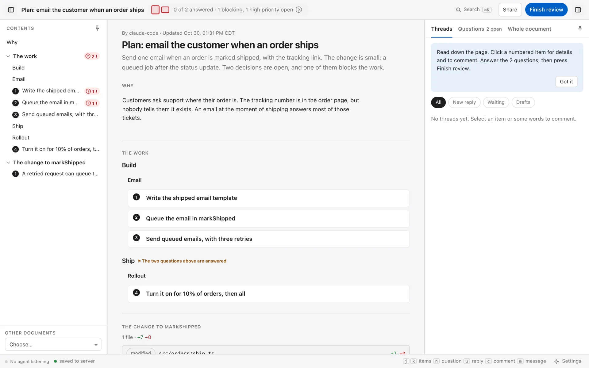
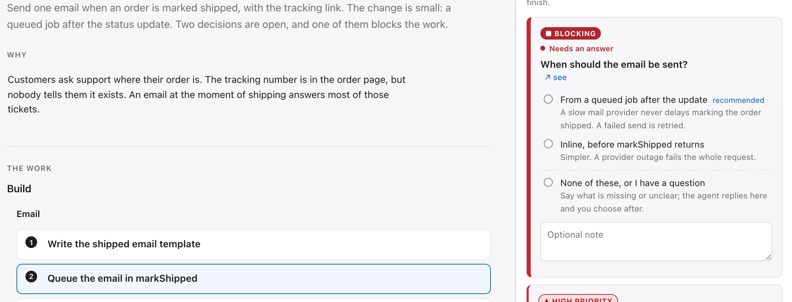
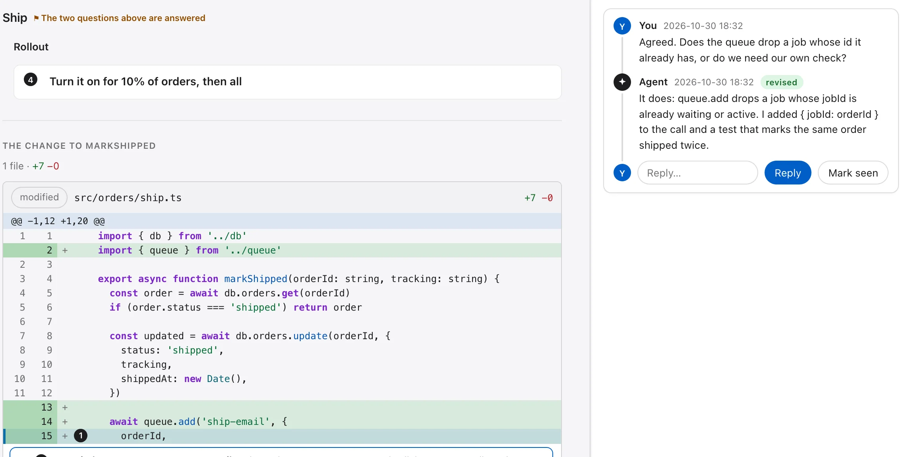
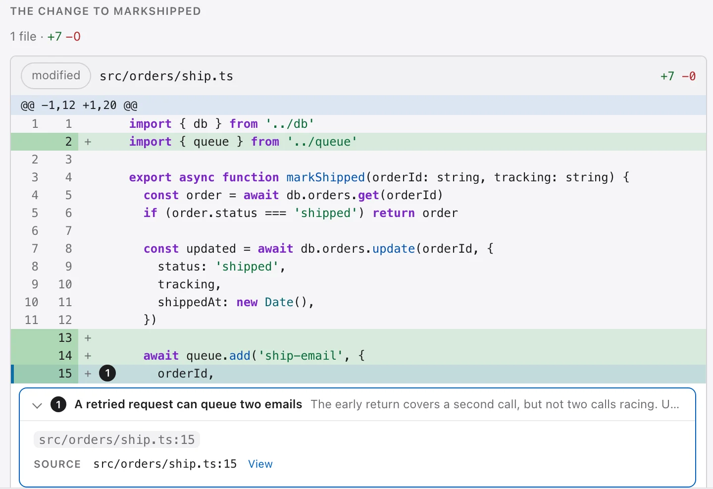
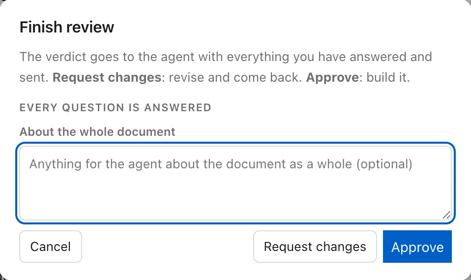

# parley

Review your agent's work on a page, not in chat.

<p class="small">Alpha · runs on your machine · Claude Code, Codex, Cursor and Pi</p>

<aside class="notes">
parley is a CLI and a set of agent skills. The agent writes a document, I review it as a web
page, and my answers go back to the agent as a file. Everything in this deck comes from one real
review, run on parley 0.2.1.
</aside>

---

## The problem

- An agent's plan arrives as a long markdown reply in chat.
- Its questions are buried in the text.
- Your answer goes back as a paragraph the agent has to read.
- When the session ends, the review is gone.

<aside class="notes">
The cost is in the middle two lines. I miss a question, or answer it in a way the agent reads
differently than I meant. Then the next session starts without any of it.
</aside>

---

## Canvases help, inside one app

- Agent apps have a canvas or preview for rich output.
- Each one works only inside its own app.
- To share it, you make it public or the reviewer joins that app.
- To keep it, you copy it out by hand.

<aside class="notes">
Claude, ChatGPT, Cursor and Codex each render rich output well inside their own app. The limits
are where it lives: a teammate on another tool can't open it without a public link, and nothing
lands in the repo unless someone saves it there.
</aside>

---

## What parley does

- The agent writes a document as JSON.
- You review it as one page in your browser.
- Your answers go to a JSON file next to the document.
- The agent reads that file, replies and revises.

<aside class="notes">
The document is typed: prose, plans, diffs, tables, questions with set options. The page is
generated from it. The answers file is data, not prose.
</aside>

---

## The page



<p class="caption">The contents, the document and the conversation. The top bar counts what is still open.</p>

<aside class="notes">
This is the agent's plan for one small feature: email the customer when an order ships. Two
questions are open, and one of them blocks the work. The contents show where each one is.
</aside>

---

## The loop

```sh
parley new ship-email-plan                      # the agent starts a document
parley check docs/parley/ship-email-plan.json   # rejects a broken one, says what to fix
parley serve                                    # the page, on your machine
parley open ship-email-plan                     # the link to give you
parley answers ship-email-plan --wait           # waits for what you send
```

The agent runs these. You open a link and review.

<aside class="notes">
The skills run this loop for the agent, so you rarely type these yourself. `check` matters most:
a document that fails it never reaches the page.
</aside>

---

## Questions with set options



<p class="caption">Each option has a reason. The agent marks one as recommended. A blocking question is listed first.</p>

<aside class="notes">
I pick an option instead of writing a paragraph. "None of these, or I have a question" is always
there, with a note, when the options are wrong.
</aside>

---

## Comment on any part



<p class="caption">A plan step, a diff line, a table cell, a region of an image. The agent replies in the thread and says what it did.</p>

<aside class="notes">
Here I asked about the duplicate-email finding. The agent answered, changed the code, and marked
its reply "revised". The thread stays on the line it is about.
</aside>

---

## Code review



<p class="caption">Diffs show the agent's findings on the lines they are about.</p>

<aside class="notes">
The same page reviews code: a working tree, a branch, a range or a pull request. Line numbers
link to the source on GitHub when the document names the repository.
</aside>

---

## Line numbers link to the code

```text
diff of a pull request      line 15  ->  github.com/<owner>/<repo>/pull/42/files#diff-…R15
diff of a branch or range   old side ->  the file at the base commit
                            new side ->  the file at the head commit
code or finding source      line 15  ->  the file at the document's commit
                            path     ->  the file in your editor
```

- Links pin to a commit, so they still point at the right line after the branch moves.
- The editor link works once you set your checkout folder on the page.

<aside class="notes">
The agent sets the repository and commit on the document, and the pull request number on the
diff. From there every number on the page is a link. Click a finding's line and you land on the
same line in GitHub's Files tab, where you can comment on it.
</aside>

---

## Reviewing a pull request

```sh
/parley:pr-review 42
```

- Reads the PR, its checks and the comments already on it, with `gh`.
- The page shows what the PR says it does and whether the diff does that, a table of checks with failing ones first, and the diff with findings.
- One question per finding, and a last one: post the review to the PR, or not.
- If you say post, it posts one review comment with the findings you kept, in your words where you changed them.
- It never approves, requests changes, merges or resolves a thread.

<aside class="notes">
It does not check the PR out over your work; it reads files through the GitHub API. The posted
review is one comment, not a comment on each line. `code-review` does the same for a working tree,
a branch or a range, with no posting.
</aside>

---

## Finish the review



<p class="caption">Approve, or request changes. The verdict goes to the agent with every answer.</p>

<aside class="notes">
If a blocking question is still open, the dialog says so and links to it. I can still request
changes.
</aside>

---

## What the agent reads back

```text
$ parley answers ship-email-plan
ship-email-plan (revision 1): verdict approved
  (finished: Ship it behind the 10% flag first.)
questions:
  q-send [blocking] · When should the email be sent?
    answered: From a queued job after the update
  q-resend [high priority] · If tracking changes after shipping, send a second email?
    answered: No, one email per order
waiting for a reply: 0
```

A choice is an option id, not a paragraph.

<aside class="notes">
The answers file holds the same thing as JSON: `"q-send": { "selected": ["queue"] }`. The agent
does not have to interpret my prose to know what I decided.
</aside>

---

## Decisions on record

```text
docs/parley/discuss-order-cache.json           the question, the options, why each, the recommendation
docs/parley/discuss-order-cache.answers.json   what you chose, who, when, and earlier answers
```

- Each answer is an option id, with who chose it and when.
- A changed answer keeps the old one in its history.
- The verdict, the finish summary and every thread are in the same file.
- Commit both files with the code. The decision sits next to what it decided.

<aside class="notes">
`/parley:discuss` writes this kind of page: the problem, two to four options with their costs, a
tradeoffs table and a recommendation. I decide. A year later, the reason for the cache design is in
the repo, not in a chat log that is gone.
</aside>

---

## Export to HTML and markdown

```sh
parley render docs/parley/discuss-order-cache.json                      # one HTML file
parley render docs/parley/discuss-order-cache.json --out cache.md       # markdown
parley check  docs/parley/discuss-order-cache.json --export cache.md    # still matches?
```

- The HTML page is one file with nothing to install. It opens in any browser, offline.
- The markdown reads on GitHub, in a PR or in a docs site. Each item keeps its id, so any line maps back to the document.
- `check --export` fails when a saved export no longer matches the document.
- **Export** on the page downloads either one with the answers as they are now.

<aside class="notes">
This is the step the in-app canvases leave to you. A static page can be reviewed without a server:
the answers download as a file to hand back to the agent. The markdown has a short header for docs
tools and hidden item ids, so it is safe to paste into a PR description.
</aside>

---

## Why typed

- `parley check` rejects a broken document before you see it.
- Your answers survive when the agent rewrites the document.
- The agent edits one item by id: `get`, `set`, `add`, `remove`, `move`.
- 23 block types: plans, diffs, tables, schemas, charts, diagrams and more.

<aside class="notes">
When the agent revises, the page updates in place. A question whose text changed shows as
changed, so I know to look again.
</aside>

---

## How it runs on your machine

```text
agent: Claude Code, Codex, Cursor or Pi
  |  node parley.mjs <command>
  v
docs/parley/ship-email-plan.json            the document; the agent writes it
docs/parley/ship-email-plan.answers.json    your answers; the server writes them
  ^  reads, watches, writes
parley serve --- 127.0.0.1:4321 ---> the page in your browser
```

- `parley.mjs` is the CLI and the server in one file, shipped in the skill's folder.
- It runs under Node 22+, Bun or Deno. Nothing to install.

<aside class="notes">
The skill tells the agent to run `node parley.mjs` from the project root. The page is built into
the same file, so `serve` needs nothing else. The server only listens on loopback and serves only
files git tracks.
</aside>

---

## One round

```text
agent                 parley serve               you
new, set, check  -->  writes the document
serve            -->  watches the folder    -->  opens the page
answers --wait        waits
                      saves to answers.json <--  comment, pick options
answers          <--  exits on the send     <--  Finish review
answers --reply  -->  adds the reply        -->  the thread updates
set, add, move   -->  file changes          -->  the page updates in place
```

<aside class="notes">
While the server runs it is the only writer of the answers file. The agent's replies go through
it; with no server running, the CLI writes under a lock instead. The page saves with a version
check, so two tabs, or a tab and the agent, never write over each other. The server records its
port and token outside the repo, in ~/.local/state/parley/, so the token is never committed.
</aside>

---

## Skills for common jobs

- `code-review`: a working tree, branch or range, with findings.
- `pr-review`: a GitHub pull request. It posts back only when you say so.
- `discuss`: a design question with options, tradeoffs and a recommendation.
- `plan`: a work plan you approve or send back.

<aside class="notes">
Each skill writes a parley page for one job, then runs the loop. In Claude Code they run as
`/parley:pr-review 42` and so on.
</aside>

---

## Kept in your repo, shared from your machine

- The same document and page in Claude Code, Codex, Cursor and Pi. No account.
- Documents and answers are files in your repo. They are kept with the code, with no export step.
- **Share** opens the page to your local network behind a token. **Stop sharing** closes it.
- The page exports a static copy, or markdown, to send anywhere.

<aside class="notes">
The server binds to loopback by default. A shared link is plain HTTP, and anyone with it can read
the files the page serves, so use it on a network you trust. Sharing beyond the local network is
in design, not built.
</aside>

---

## Next: sharing through a relay

```text
your machine                    relay                   reviewer
parley serve  -- encrypted -->  orders and stores  -->  browser viewer
plain files   <-- encrypted --  ciphertext only    <--  key from the link
```

- **Share on the internet** makes a key, then uploads the document and answers, encrypted.
- The key is in the link after the `#`. The browser never sends it, so the relay can't read the review.
- The agent's commands do not change. Stop sharing, and the review is local again.

<p class="small">In design. Three relay backends are being built and measured against one spec.</p>

<aside class="notes">
The local server stays the source of the files and encrypts at the boundary. The relay numbers
each change and stores it; it sees which lane a change is on, never its content. Later, a room:
several people and their own agents in one review, each with their own model. A free room is one
document with a limited life.
</aside>

---

## Install

```sh
# Claude Code
claude plugin marketplace add osdlc/parley
claude plugin install parley@parley

# Codex
codex plugin marketplace add osdlc/parley
codex plugin add parley@parley

# Cursor: add the marketplace, then install parley in the Cursor app
cursor-agent plugin marketplace add https://github.com/osdlc/parley

# Pi: install from a clone, and keep the clone where it is
git clone https://github.com/osdlc/parley
pi install ./parley/.pi/packs/parley
```

<p class="small">One marketplace for all four. Node 22+, Bun or Deno; nothing else to install.</p>

<aside class="notes">
In a Claude Code session it is `/plugin marketplace add osdlc/parley`, then
`/plugin install parley@parley`. `cursor-agent` has no install command, so the last step in Cursor
is in the app. Pi records the clone's path. The npm package is not published yet.
</aside>

---

## Status

- Alpha. The file format may change.
- One reviewer at a time.
- Sharing beyond your network is in design, not built.

<p class="small">github.com/osdlc/parley</p>

<aside class="notes">
Questions and bug reports go to the GitHub repository.
</aside>
